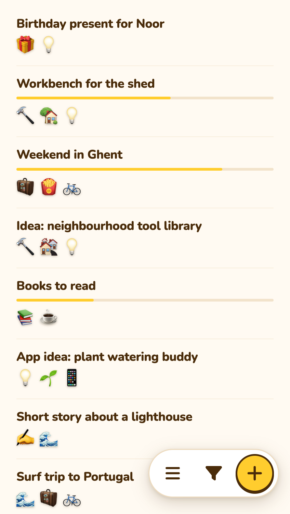
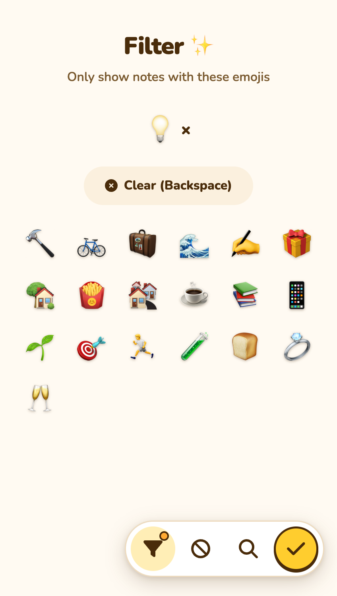
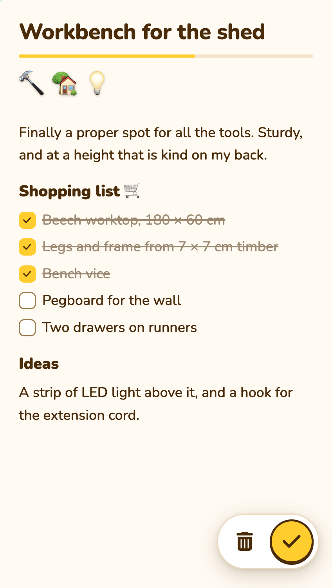

# Happy Notes
_A note-taking app for ~~chaotic~~ free-spirited minds_

**No folders, no tags, just emojis ✨**

<p>
  <picture>
    <source srcset="public/images/screenshot-1-notes-list-v5-dark.png" media="(prefers-color-scheme: dark)">
    
  </picture>
  <picture>
    <source srcset="public/images/screenshot-2-filter-v5-dark.png" media="(prefers-color-scheme: dark)">
    
  </picture>
  <picture>
    <source srcset="public/images/screenshot-3-note-v5-dark.png" media="(prefers-color-scheme: dark)">
    
  </picture>
</p>

## Contents 📑
- [What](#what-)
- [Why](#why-)
- [How to use](#how-to-use-)
  - [Docker](#docker)
  - [Without Docker](#without-docker)
  - [Local development](#local-development)
  - [Hosted version](#hosted-version)
- [Issues & PR's](#issues--prs-)
- [Say hi](#say-hi-)

## What 📝
Happy Notes is a simple web-based (Laravel) note-taking app where you categorize notes with emojis instead of words.

Built with Laravel 12, Livewire and Editor.js. Runs on PHP 8.4 with SQLite or MySQL, with two-factor login and export to CSV or JSON. No tracking, no external services.

## Why 🤷
No note-taking app ever felt natural to me. I tried paper, various apps, and other tools—but I always lost track. Either too messy or too rigid. So I built my own: simple, visual, emoji-based. Now, I can finally organize my ideas in a way that works for me.

## How to use 🚀
You can run Happy Notes yourself, or use the [hosted version](#hosted-version).

### Docker
The quickest way to run it yourself:

```bash
git clone https://github.com/rickvanderwolk/happynotes.git
cd happynotes
docker compose up -d --build
```

Then open [http://localhost:8080](http://localhost:8080) and sign up. Port 8080 already taken? Start it with `HAPPYNOTES_PORT=8081 APP_URL=http://localhost:8081 docker compose up -d --build`.

- Your notes live in a SQLite database in the `happynotes-data` volume. Back up that volume and you have everything.
- Running it on your own domain? Set `APP_URL` in `compose.yaml`. Behind a reverse proxy with HTTPS (Caddy, Traefik, nginx), also set `TRUSTED_PROXIES`, but only when the container is reachable through that proxy alone: bind the port to localhost (`127.0.0.1:8080:80`) or put both on the same Docker network without publishing the port. Otherwise anyone can fake their IP address.
- Emails (password resets) are written to the log until you set up SMTP in `compose.yaml`.
- To update: `git pull` and `docker compose up -d --build` again. Migrations run automatically on start.

### Without Docker
Set it up like any other Laravel app (PHP 8.4, SQLite or MySQL):

```bash
composer install --no-dev
npm ci && npm run build
cp .env.example .env
php artisan key:generate
php artisan migrate
```

`.env.example` is set up for local development. Before going live, set `APP_ENV=production` and `APP_DEBUG=false` in `.env`: otherwise visitors see error details, logins are not rate limited and the test routes are open. Then point your web server at the `public` folder.

### Local development
To work on Happy Notes itself (PHP 8.4, Composer, Node.js):

```bash
make install
cp .env.example .env
php artisan key:generate
touch database/database.sqlite
make fresh
make serve
```

Open [http://127.0.0.1:8000](http://127.0.0.1:8000) and log in as `user1@example.com` / `password1`. `make analyse` runs the static analysis, `make test` the tests (with `make serve` running) and `make docker-check` checks the Docker image.

### Hosted version
Not into self-hosting? No worries! You can use the [hosted version](https://happynotes.cc) for free (hosted in the Netherlands, EU), and since I don’t expect a large user base, that’s not changing anytime soon. If it ever does, I’ll figure something out. Either way, your notes are yours—you can always export them (currently as CSV or JSON) via `account` > `export data` and run your own instance from this repo.

## Issues & PR's 🧩
Happy Notes is a personal side project. I use it every day, so I keep it up to date, but it's mainly built for myself and shared as is. I would truly appreciate any ideas, issues, and / or PRs, but I’ll only work on what fits my vision and time. It’s fully open source, so if I’m too slow—or if you have your different ideas—feel free to fork it and make it yours 😊 If you’d like to contribute, pull requests are always welcome! 💛

## Say hi 👋
If you enjoy this project, please drop me a note at [hi@happynotes.cc](mailto:hi@happynotes.cc)
